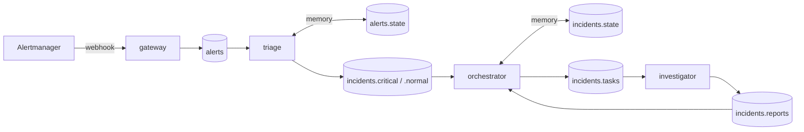

# ein-agent-mesh

Kafka as the control plane between SRE agents. Alerts come in, a few investigated incidents come
out, people decide what to do. Every agent reads one stream, decides, writes to the streams it owns.
Infrastructure access is read-only.

## Read

- [The mesh in two minutes](docs/explanation/overview.md): the concepts, nothing else.
- [Lifecycle](docs/explanation/lifecycle.md): the states an incident passes through and who moves it.
- [Design rules](docs/explanation/design-rules.md): the rules every topic and role follows, and why.
- [Triage](docs/explanation/triage.md): why rules go first and the model under-merges.
- [Tools](docs/explanation/tools.md): how the investigator looks at the infrastructure without being able to touch it.

## Do

- [Run the mesh](docs/how-to/run-locally.md): deploy Kafka, create topics, start the roles, replay a storm.
- [Run and write evals](docs/how-to/evals.md): score a scenario, debug one stage, add a scenario.

## Look up

- [Topics](docs/reference/topics.md): every topic, its key, record and fields.
- [Commands](docs/reference/cli.md): every `ein-mesh` command and `just` recipe.
- [Settings](docs/reference/settings.md): every environment variable and Terraform input.
- [Evals](docs/reference/evals.md): scenario files, stages, scorer columns.
- [Tools](docs/reference/tools.md): the sources, the tools the model calls, the sizes.
- [Python API](docs/reference/python-api.md): `Role` and `MessageBus`.

## Status

- Implemented: gateway, triage, orchestrator (owns the incident, issues tasks, folds reports into
  its memory, retries), investigator with read-only tools over Prometheus, Loki and Alertmanager
  (`packages/ein-utcp`), the topic model, evals.
- Next: the orchestrator's own model turn, then `closed` and the chat frontend.
