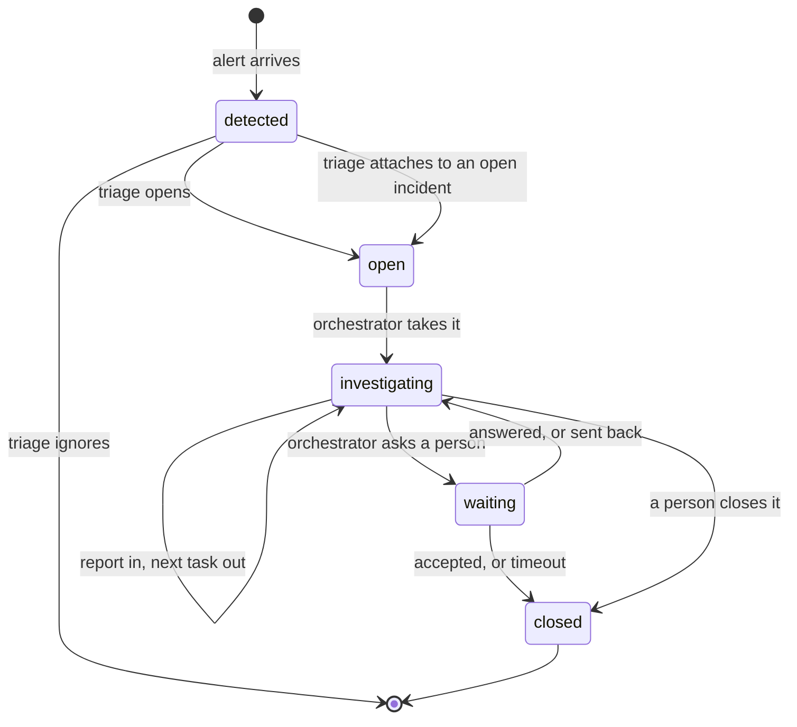

# Lifecycle

An incident moves through five states. Each move has exactly one agent allowed to make it.

## States

| State | Means | Lives on |
| --- | --- | --- |
| detected | an alert exists; nobody has judged it | `alerts` |
| open | one thing worth investigating, with an id, a priority, a reason | `incidents.critical` / `incidents.normal` |
| investigating | the orchestrator owns it; tasks may be outstanding | `incidents.state`, `status=investigating` |
| waiting | blocked on a person: a question is open | `incidents.state`, `status=waiting` (frontend not built yet) |
| closed | a person accepted the conclusion, or silence counted as acceptance | `incidents.state`, `status=closed` (not built yet) |

## Who moves what

- Into and within `open`: **triage**. Open, attach, and later merge.
- Out of `open` and everything after: **orchestrator**.
- Investigators only report. The frontend only relays. Neither changes a state.
- Why one owner: two agents reacting to the same state duplicate work or loop.

## What a state remembers

- `open` is a message: the incident with its alerts inline, consumed once.
- `investigating` onward is the orchestrator's memory: status, title, priority, the tasks issued,
  and `context`, a bounded summary (16 KB) of what is known. A restart reads the memory and continues;
  nothing is replayed.
- While an incident is open, triage remembers why each alert was attached or ignored. When it closes,
  that memory goes with it. A human-facing history arrives with the frontend.

## What ends an incident

1. A person answers the final question: accept, or send back. Timeout means accept.
2. A person closes it directly, from any state.
3. All alerts resolving is a hint to post the report, never a close.

## Built so far

- `detected → open`, `open → investigating`, and the loop inside `investigating`: one task per
  incident, a report back, retries with a pointer to the failed attempt, findings folded into the
  incident's memory.
- Not built: the investigator's tools, the orchestrator's own model turn, `waiting` and `closed`
  with the frontend's questions and answers.
