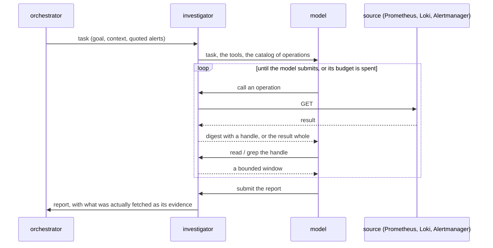

# Tools

How the investigator looks at the infrastructure, and why it cannot touch it.

## Two planes

Agents talk to each other over Kafka, and only the runtime reads those messages. Agents talk to the
infrastructure through tools, and only the investigator has any. The two never mix: a tool result is
never put on a topic as it came back, and a topic record is never handed to a tool. What crosses from
one plane to the other is a report, written for a reader.

## Reading is the only thing that exists

Each source's API is described by a specification shipped with the code. When it is loaded, every
operation that is not a read is dropped before it can become a tool. The model is never told "do not
write"; there is nothing it could call. This holds whatever the account behind the endpoint would
allow, and it is why a misled model, or a prompt hidden in a label, can at worst read more.

## A result is looked at, not pasted

A list of a few hundred alerts is tens of kilobytes. Pasting it into the conversation would fill the
context in a few calls; cutting it off would lose the rows at the end, which is where the odd one often
is. So a large result stays in the runtime and the model receives a digest of it: how many items, the
distribution of the fields that take few distinct values (severity, namespace, state), a few sample
rows, and a handle. With the handle it reads a window, projects just the fields it needs, searches for
a record, or asks for the call to be run again. The whole set is counted once; nothing has to be paged
to be known.

## The budget is the safety valve

The budget is what an investigation really costs: tokens, as the model reports them turn by turn, and
time. Counting calls would say nothing about either; one call can fetch a few hundred bytes or a
digest of hundreds of records. When tokens or time run out the model is told to submit what it has, and
the runtime forces the submission if it does not. The last share of the task's time is kept for exactly
that, so a report is handed over rather than lost to a timeout. A repeated identical call is refused in
favour of the handle it already has. The investigation always ends, with a report or with a failure the
orchestrator can retry.

## The receipts are the runtime's

Every call that went out is recorded with its arguments, in order. That record leads the report's
"resources checked"; whatever the model says it looked at comes after. A person reading the report can
tell what was fetched without having watched the run, and a model that claims to have checked something
it did not is contradicted by the record.

## Each source speaks for itself

Prometheus, Loki and Alertmanager differ in small ways: where the records sit in a result, whether a
query can be checked for syntax before it is sent, how the API is described. Each source decides those
things for itself; the shared code is only the contract and a default. Adding a system is adding a
source, and nothing shared changes.
